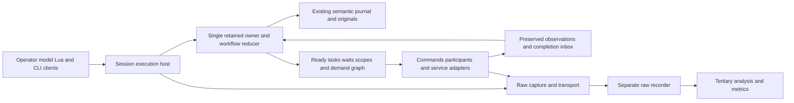

# Concurrent and durable programmable workflows

Proposed design for operator discussion, 2026-10-14. Source baseline64d75fb;
research and independent review are in [the campaign](../papers/workflows-2026-10-14/CAMPAIGN.md).
This specifies the destination and the mechanisms required to reach it. It does
not report an implementation or authorize an unselected library. C++20 owns
execution, retention and lifetimes; Lua5.4.8 authors behavior. Performance tuning
is a requirement throughout delivery, not an optional postscript.

## Purpose and competitive bar

Blackbird should make an ambitious coding operation an executable, inspectable,
evolving program: several models investigate, tools run concurrently, evidence
arrives out of order, the operator changes direction, useful work survives a
controller restart, and builds/tests/artifacts are reused only when justified.
The same execution machinery must also support scientific pipelines, build
graphs, statecharts, event-driven services and durable functions. Workflow
paradigm, model, execution location and operator presence are independent choices.

Current offerings already supply much of the baseline. Forks, task trees,
checkpoint replay, agent cold revival and durable timers are competitive
obligations, not inventions. The proposed advance is their composition with
explicit effect reconciliation, independently progressing tasks, editable context
lineage, resource-aware execution, incremental demand, and coherent live change.
The [comparison study](../papers/workflows-2026-10-14/COMPARISON.md) assigns each
claim a concrete demonstration. No design establishes universal superiority.

The core must make these operations ordinary:

- Start a durable workflow from Lua, a model, the terminal or CLI; obtain the same
  run identity and inspect it while unrelated work proceeds.
- Spawn tool-using participants across configured providers; choose independent
  contexts, workspaces and programs; communicate outside the parent tree.
- Join all, first, first successful, quorum or a program-defined condition without
  mistaking a selected result for stopped losers or settled external effects.
- Restart the orchestration and recover known results, durable waits and selected
  decisions without inventing another identity for an already dispatched effect.
- Replan from retained evidence, fork an experiment, demand a changed artifact,
  and publish a selected source proposal after checking its actual base.
- Change workflow source, tools or models through the established conclusion or
  interrupt-and-apply boundary, with old callbacks and results still attributable.
- Run indefinitely in station mode and attach/detach an operator interface without
  replacing the execution owner or sharing a mutable model conversation.

## Existing machinery and integration boundary

The [native inventory](../papers/workflows-2026-10-14/native-inventory.md) is the
source map. WorkflowRegistry already retains definitions and dispatch metadata.
CodingEngine executes workflows through child Lua VMs but synchronously shares
one engine/context; its volatile continuation FIFO is not durable execution.
Participants supplies actual worker threads, retained admission and addressed
controls, but running rows reopen as unknown. CommandJobs supplies native child
identity, bounded output, input/control and honest settlement. RetainedState,
ContextStore, immutable payload storage and saved-state/suffix recovery provide
the retention foundation. Candidate pools already manage bounded checkout leases.

Extend these components rather than placing a second ledger beside them:

| Component | Proposed responsibility |
| --- | --- |
| WorkflowRegistry and program configuration | Immutable definition manifests, discovery, callable aliases and staged activation. |
| Native WorkflowRuntime | Run/node state reducer, ready queues, wait indices, durable decisions and fair owner inbox. |
| Existing RetainedState owner | Single-writer commit of orchestration, effect identities, original references and context publication. |
| Participants and executor adapters | Owned independent execution; completions and original byte references returned through the owner inbox. |
| CommandJobs and native tool boundaries | Existing effect admission, commands/PTYs/control and actual syscall/result observations. |
| ContextStore | Independent participant/request branches and version-checked explicit import/publication. |
| Saved state and archive catalog | Current live run projection, bounded suffix recovery and demand-read historical data. |
| Terminal, model tools, Lua and CLI | Clients of shared native operations; no separate execution state machine. |



The current operation path allocates new decisions/invocations/attempts on every
call. Durable execution needs a call path that consumes identities allocated by
its retained decision. Current reopen recovery assumes one planned invocation;
multi-command decision recovery requires a new typed reducer. Saved-state label
coverage and the settled-only eligibility rule must also be extended. A run
snapshot alone cannot supply bounded or correct recovery.

## Execution owner and concurrency

One native owner serializes semantic transitions for an environment. It accepts
operator submissions, worker completions, command observations, messages, timer
events and retention failures through one fair inbox. Workers never mutate a Lua
VM, ContextStore or the retained ledger belonging to another owner. Each VM has
one execution owner and immutable pinned program inputs. There is no global
superstep: a completed node can enable its successors while unrelated nodes run.

Ready work is indexed by actual dependency/condition changes; a completed task
does not scan the entire run graph or archived transcript. Runnable Lua segments
use configured instruction quanta; yielding releases their execution slot. Native
blocking effects run in owned workers or separately governed executors. A stuck
trusted extension is a visible cancellation/settlement limit; cooperative Lua
preemption does not forcibly terminate an arbitrary native call.

The scheduler survives the conclusion of an operator turn. Background runs have
an explicit standing scope. Terminal detachment never destroys that scope or
cancels its work. Normal shutdown stops admission and settles owned resources;
durable orchestration reopens from records. Keeping live children through a main
process replacement additionally requires the independent custodian/refit unit;
durable state is not a claim of preserved process heaps or PID adoption.

Concretely, a session execution host owns the session lock, RetainedState,
WorkflowRuntime and executor registry independently of all client processes.
The first client either connects or starts that host under an exclusive owner
acquisition protocol. The host creates/opens RetainedState and its raw-storage
grant in its own process before detach is allowed. RawRetainedTransfer remains
exclusive thread-to-thread transfer INSIDE that host; its process-bound objects
and grants do not move through IPC. Moving an already running UI-owned session
requires settle/close/reopen, or a separately specified cross-process handoff;
detach stays blocked until actual host custody exists. Closing every UI closes
attachments only. Reconnect validates the existing host incarnation/epoch; endpoint
loss or heartbeat expiry is not takeover authority. Host shutdown/crash has its
own settlement/recovery path, distinct from UI disappearance.

Use a bounded native worker pool, per-provider/executor queues and one owner
event loop rather than one thread per graph node. Explicit operator profiles may
remove logical limits where practical; actual storage, process and provider
limits still constrain execution. Admission reports those limits and the chosen
queue/refusal behavior rather than silently dropping work.

Scheduler-owned await operations park an owned continuation and return the
physical pool worker to service. Releasing a logical CPU permit while a worker
thread blocks does not supply progress. No pooled executor synchronously waits
for descendant work requiring that same pool. A nonresumable blocking adapter
declares its occupied worker; nested work uses a separately budgeted executor or
is refused with the dependency conflict. Owner completion/control service and
finite cleanup do not depend on ordinary executor pool availability.

Every suspendable Lua task is registry-rooted and resumed by its single VM owner.
Before yielding, an async bridge moves arguments, result/error storage, attempt
and generation identity, cancellation and capture linkage into an owned native
continuation. Foundation trampolines validate task/VM incarnation; workers only
enqueue completion. Use Lua's yieldable continuation APIs, never stack-local
C++ frames as resume state. Nonyieldable trusted extension regions expose their
quantum/cancellation limit. VM close settles or explicitly transfers associated
operations. Selected Lua5.4.8 yield/resume/error/allocation/cancel qualification
belongs to F6; older runtime research does not qualify this bridge.

## Identities and state

Typed identities distinguish definition, run, scope, node, decision, invocation,
attempt, wait, message, schedule, occurrence, artifact and workspace lease. A
stable NodeKey consists of run identity, definition-local name, enclosing
expansion/iteration identity and explicit logical input key. Display names and
array positions are insufficient. An identical submission key plus identical
canonical native inputs returns the existing submission; changed inputs conflict.
Input equality compares full retained values/bytes, not a collision-prone digest
alone. Idempotent submission is distinct from reusable result caching.

Each node retains its definition manifest, selected inputs and context revision,
scope/resource policy, planned command identities, current decision/state, and
output/diagnostic references. Keep three independent facts:

1. Scheduling condition: ready, waiting, paused, draining or blocked.
2. Logical outcome: absent, success, failure, cancellation or unresolved.
3. Execution settlement: outstanding local custody, settled locally, and actual
   external disposition known or unknown.

`result_ready` means a logical result can be observed. `settled` means the stated
owned local obligations have ended. Neither success nor local settlement proves
that all remote effects are complete. `reconciliation_required` names affected
attempts and the observations needed to advance; it does not erase a usable
partial result. These are typed facts with derived views, not several conflicting
authoritative status strings.

Normal durable recovery preserves logical actor/run/node/invocation identities,
accepted inbox addresses and durable state, while creating a new execution
incarnation/owner epoch. Stable logical endpoints can accept retained input during
downtime under their profile. `stop_incarnation` loses live execution without
retiring the actor. `retire_actor` persists a tombstone and prohibits automatic
revival. Explicit replacement creates a linked successor with declared transfer
of inbox entries, waits and unresolved observation obligations. Recycled names
never transfer identity or late replies implicitly.

## Authored application state and fork policy

Workflows can author typed revisioned application cells: plans, result tables,
partition cursors and settings. A cell has stable identity, schema, owner/profile,
current immutable value and source history. Segment planning receives a consistent
snapshot/read set. Its decision can compare expected revisions and update several
cells atomically with state, inbox consumption, commands and context publication
in the same existing retained transaction. A stale read/write set rejects without
effects; pure planning may recompute. No second application-state database is added.

Recorded-command code observes cell reads and updates through that decision
surface. Watchers wake after committed cell changes. Branch-local snapshots,
copies and current references are distinct fork policies: `as_of` selects retained
values at the fork revision; `current_at_fork` pins the parent's actual current
values; `fresh` initializes new schema state. Live shared cells require an explicit
shared owner/revision contract, not an alias accidentally copied through Lua.
Multi-cell atomicity is within one retained owner; cross-environment transactions
need an external protocol and cannot inherit the local guarantee.

## Two authoring surfaces over one runtime

**Explicit durable segments** are the reference semantics. A named transition
receives immutable state, an explicit selected inbox/event set, known command
results and its pinned manifest. It computes a native plan: next state, stable
command declarations, wait/subscription changes, consumed event IDs and proposed
outputs. Planning performs no external effect. Its next transition is persisted;
no Lua closure, coroutine stack or opaque userdata is advertised as recoverable.

**Recorded-command functions** provide familiar sequential/branching Lua with
concurrent start/await calls. They replay a pinned function against recorded
commands/results to reconstruct the current program point. Every command uses
an explicit structural key and matching operation/schema/input/manifest. Known
results return without dispatch; retained pending handles remain pending.
Nondeterministic observations—time, randomness, outside reads and model decisions—
come through recorded commands. Replay cannot execute native effects or use
ambient mutable modules, live file imports or unrecorded nondeterminism.

Replay is constrained code reexecution, not arbitrary VM serialization. Pin the
Lua/runtime numeric and iteration profile; require explicit ordering when a map
affects command order. Mismatch stops before new dispatch and exposes the first
changed command. Effect identity must be looked up before reaching the ordinary
fresh-call seam. Large histories can place explicit segment checkpoints, reducing
reconstruction to current state plus relevant suffix. The recorded function
frontend compiles/lowers to the same retained decisions; it has no separate
recovery store or effect policy.

Replay retains an explicit ordered/partially ordered command frontier, not merely
a dictionary of keyed results. Before fresh dispatch or successful return, every
required historical command through that frontier is matched exactly once by
structural identity and semantic signature. Missing, duplicate, incompatible or
order-sensitive reordered commands reject. Checkpoints retain the covered frontier
and pending-handle roots. Migration can retire/transfer an omitted command only
through its explicit obligation map; A/B becoming A/C cannot dispatch C or claim
completion while B disappears. Partial branch reexecution gets new lineage and
declared reuse rather than substituting a same-key action.

Ordinary process-lifetime Lua/coroutines remain available for unconstrained live
programming. Their handles expose `durability=process`, and their recoverable
boundary is an explicit segment handoff. A durable parent may supervise such a
child, retain its outputs and handle loss, but cannot label its stack durable.

Illustrative proposed API, not currently available:

```lua
local run = blackbird.workflow.start{
  definition = "repair_matrix", version = "selected",
  input = {source = source_ref, faults = fault_refs},
  scope = "standing", profile = "development"
}
local observed = blackbird.workflow.read{run = run.id, view = "frontier"}
```

An explicit segment expresses a recoverable concurrent decision:

```lua
function launch(state, event)
  return wf.plan{
    state = {phase = "testing", source = state.source},
    start = {
      wf.command("linux", "exec", linux_arguments),
      wf.command("mac", "exec", mac_arguments),
      wf.command("critic", "participant", review_arguments)
    },
    wait = wf.join{"linux", "mac", "critic", mode = "all"},
    next = "assess"
  }
end
```

The names are scoped structural keys. Native admission supplies identities and
actual observations; an authored table cannot assert that an external action was
not dispatched or already settled. Returned state supports owned scalar/value
types, bytes and retained references. Cycles, functions and opaque mutable native
objects are rejected as checkpoint state with useful location/type guidance.

The recorded-command surface should make ordinary composition concise. This
complete proposed function illustrates the contracts; `wf` is the native
task-local facade, not an already installed module. Definitions, schemas and
predicate code referenced below are pinned by the run manifest.

```lua
function repair_campaign(wf, input)
  local scope = wf.scope("repairs", {profile = "development"})
  local shards = wf.call("discover", "workflow", {
    definition = "discover_faults", input = {source = input.source}
  }) -- nested durable callable; schema requires unique stable shard IDs
  if shards.outcome ~= "success" then
    scope:close{policy = "cancel_and_drain"}
    scope:await_settlement()
    return wf.result(shards.outcome, {evidence = shards.originals})
  end

  local expansion = scope:expansion("reviewers")
  for _, shard in ipairs(shards.value.items) do
    expansion:start(wf.key("review", shard.id), "participant", {
      program = "investigate_and_test", provider = shard.provider,
      context = wf.context.select(input.context, shard.source_refs),
      input = {source = input.source, fault = shard},
      workspace = {mode = "isolated_candidate", base = input.source}
    })
  end
  expansion:close() -- closes this producer, not every observer or scope

  local choice = scope:await_result("qualified_pair", {
    members = expansion.id, mode = "quorum", k = 2,
    predicate = "behavioral_tests_passed_v1",
    deadline = input.review_deadline, cutoff = "owner_acceptance"
  }) -- typed success/timeout/cancelled/impossible/unresolved, no hidden throw
  if choice.outcome ~= "success" then
    scope:close{policy = "cancel_and_drain"}
    scope:await_settlement() -- local custody; reports remote unknowns separately
    return wf.result(choice.outcome, {evidence = choice.originals})
  end

  scope:cancel(choice.pending, {reason = "qualified pair selected"})
  local checked = wf.call("integrate_and_test", "workflow", {
    definition = "build_matrix",
    input = {source = input.source, proposals = choice.selected}
  })
  local published = nil
  if checked.outcome == "success" then
    published = wf.artifact.publish("tested_proposal", {
      artifact = checked.value.artifact,
      expected_target = input.target_revision,
      eligibility = checked.value.eligibility,
      consumed = checked.value.input_revisions
    }) -- checked proposal publication; no implicit main merge or activation
  end
  scope:close{policy = "drain"}
  local settled = scope:await_settlement()
  local outcome = checked.outcome
  if published and published.outcome ~= "success" then
    outcome = published.outcome
  end
  return wf.result(outcome, {
    proposal = published, selected = choice.selected,
    pending_effects = settled.unresolved_effects
  })
end
```

Every start/call/wait/control/publication above has a stable key and retained
result. A wait parks the continuation and returns the pool worker. Cancelling
the wait alone returns a typed observation; it does not cancel observed work.
Scope owner controls explicitly do that. A stale publication returns a typed
conflict with retained proposal/lineage, not success or erased output. External
effect reconciliation may remain required after local settlement. The same
definition is callable from model tools, CLI, operator commands and station events.

## Durable decision and effect protocol

One committed decision batch contains: base run revision; governing manifest;
selected/consumed inbox identities; complete next state/continuation; stable node,
invocation and attempt identities; immutable inputs or exact original references;
wait/message/artifact publication intents; and dispatch eligibility. Conflicting
base revisions reject before effects. Newly planned commands become eligible
only after the batch's actual durable boundary. Memory publication failure after
commit recovers from that commit rather than asking Lua to plan again.

Release is a guarded retained transition on the current attempt and run/scope
revision. It rechecks owner epoch, cancellation/pause, applicable manifest,
publication eligibility and actual resource/lease grants. Planning-time eligibility
is necessary, never sufficient. Cancellation winning this guard gives unreleased
work a known-not-dispatched outcome; release winning first creates possible
execution that subsequent controls must observe honestly. The actual dispatch
endpoint checks current authority; a remote endpoint lacking fencing cannot
promise that revocation prevented a previously sent external effect.

The owner dispatches through existing effect boundaries only after that durable
release. Admission is not execution. A crash around release may make dispatch
uncertain; a missing result never permits repeating a release. Exact returned
bytes and observed dispositions settle the original attempt. Deliberate retry
allocates a new attempt under the original logical invocation and retains why.

The existing RetainedState fence remains: a recovered attempt cannot dispatch
again. For committed but unreleased work, recovery first verifies a complete,
unambiguous retained frontier proving no release, current exclusive owner and
exact inputs. A recorded recovery decision can close that old attempt as
verified-not-dispatched and admit a successor attempt under the SAME logical
invocation. Only the successor may pass current release guards. Torn, ambiguous
or unavailable release history stays unresolved; recovered evidence is never
relabeled live. Recovery restores plans, not unconditional launch permission.

| Crash or failure boundary | Required recovered behavior |
| --- | --- |
| Before decision commit | No commands eligible; selected events remain unconsumed. Recompute pure planning if desired. |
| After commit, before durable dispatch release | Preserve logical command/state. Proven-unreleased old attempt can receive a recorded successor attempt under the same invocation; current cancel/pause/epoch/resource guards still decide release. |
| After release, before dispatch observation | Expose uncertainty; reconcile through actual executor capability. No inferred nonexecution. |
| After actual effect, before result commit | Preserve available originals; reconcile the same attempt. Never manufacture a fresh logical command. |
| After result commit, before waiter notification | Reconstruct ready waiters from retained result/selection. No repeated effect. |
| After join selection, during loser cancellation | Recover the same selected winners and remaining settlement obligations. |
| During publication or migration | Recover the committed revision, or retain the failed isolated candidate and actual unresolved obligations. |

Adapters declare capabilities separately: submission deduplication and its scope;
query/reconciliation by stable request ID; idempotent action contract; resumable
stream cursors; observed cancellation; pure repeatability; compensation; and
external fencing. Unknown support is unavailable, not assumed. Provider requests,
arbitrary commands and remote writes have no universal exactly-once guarantee.
An external transaction can strengthen its own boundary without strengthening
every tool in the workflow.

A tool exposing several native actions plans and admits their child invocations
separately, so an interrupted compound operation retains each known outcome.
Opaque shell/service code may contain unobserved subactions; its aggregate attempt
remains uncertain and cannot claim per-subaction recovery. Decomposition is a
capability, never inferred from a tool name or a model's assurance.

Compensation is a separately admitted effect with its own uncertainty, dependency
order and failure. It does not undo elapsed time, sent messages or arbitrary
external changes. A workflow may continue independent branches while an affected
publication waits for reconciliation. Reconciliation operations retain observations
and the actor's interpretation; an operator assertion does not become a syscall
observation. The useful distinction is what action the evidence permits next.

## Structured concurrency and durable joins

A scope owns its admitted descendants, resource policy and exit obligations.
The default lexical scope closes by stopping new admission and draining its
children. A result can be delivered earlier through an explicit observation.
Detachment transfers a child to a named standing scope in one retained ownership
transition; children never become ownerless. Spawning lineage, execution custody,
publication authority and communication topology remain separate relationships.

Join descriptors pin a member set or a precisely named closing expansion, success
predicate version, required count, deadline and loser/failure policies. Modes:

- `all`: every selected member has a terminal logical outcome; `all_success`
  additionally requires success. Result rows retain input order and failed members.
- `first`: first eligible terminal outcome, including failure.
- `first_success`: first member whose retained outcome satisfies success.
- `quorum(k)`: first k qualifying distinct members; failures can make k impossible.
- `select`: first eligible named event/result/timeout under an explicit predicate.
- `collect`: incremental identified results with a closing condition, not an
  ever-growing unbounded resident array.

Persist selected members, their qualifying observations and the selection revision
before exposing the selection or requesting loser actions. Arrival order at the
owner is a specified local selection order, not global physical order. Pin a
cutoff profile: by default eligibility uses owner-accepted monotonic time against
the wait deadline, with retained sequence and identity only breaking actual ties.
A delayed timer callback cannot qualify a result accepted after that deadline.
An event-race profile using accepted timeout order is separately explicit.
Batching preserves already assigned acceptance order. Reopen uses retained
acceptance/selection observations and never selects different winners.

Failure policy explicitly chooses continue, stop further admission and drain,
cancel siblings and drain, or transfer permitted work to a standing scope.
Selection policy separately chooses leave losers running, cancel them or observe
them later. Both `await_result` and `await_settlement` are observational. Closing
or draining a scope is a separately admitted owner-authorized operation; a lexical
owner convenience may explicitly combine close-and-await. Cancelling a waiter
changes its observation unless it also owns and explicitly
cancels the observed work. Timeouts report waiting/selection outcomes, not command
termination. Unknown external losers remain visible after local drain.

Maintain a wait graph for owned dependencies and keyed resources. Reject a
detectable cycle with its actual path before installing the wait. Unknown external
dependencies remain unknown; cycle detection is no universal deadlock oracle.
An expansion has independent membership revisions and close/abort records.
Each observing join pins its membership acceptance policy and cannot implicitly
close a shared producer. `all` and final collection require declared producer
closure plus final member outcomes. First/quorum can select early only under an
explicit policy: their selection freezes, and later members remain outside that
selection unless a separately admitted action observes/controls them. Loser
actions apply to an identified eligible set, never future siblings implicitly.
Impossibility requires final outcomes plus closed membership or a declared finite
bound. A retry creates a successor result revision; it never changes an old
selected outcome. Predicates are pinned pure functions over retained inputs or
recorded model decisions. Upstream retraction causes a new decision/revision,
not mutation of a committed join; closure-dependency cycles are detectable waits.

## Cancellation, pause and supervision

Cancellation has request identity, scope/revision and cause; it stops future
admission, propagates according to policy, and records control attempts and actual
observations. Cancellation acknowledgment, child exit, stream closure, local
settlement and remote disposition are distinct. Protected credit and cleanup
resources are obtained before effectful dispatch so saturated ordinary queues
cannot strand stop/reap/error records. A callback cannot spend another owner's
cleanup bank or release a lease before actual users stop.

Pause admission, park at a segment boundary, pause owned cooperative workers,
and suspend an OS process are different controls. A remote service is not paused
by pausing its Blackbird consumer. Boundary pause preserves admitted work unless
the explicit policy requests cancellation; a UI must display that difference.

Supervisors choose restart policy by failure class, with shared retry budgets and
bounded escalation across the hierarchy. Restarting orchestration reconstructs
state; retrying an external action needs that action's capability/disposition.
One-for-one, cohort cancellation or dependent-subgraph repair are programs over
the same scopes. Nested supervisors cannot multiply a root attempt budget.
Completed known work is retained during repair. Unsafe arbitrary Lua stacks become
lost live children with named obligations, not resurrected workers.

## Resource policy, fairness and workspace ownership

Profiles govern runnable native work, active provider requests, memory/payload
retention, disk headroom, executor-specific permits, usage/attempt budgets and
placement. Resolve provenance from operator, environment, run and task overrides.
Subtrees consume the same aggregate root grants; nested fan-out cannot each claim
the whole machine. Report provider usage as usage, and money only when actual
account/pricing evidence permits it.

Parked coordinators release runnable CPU/request slots while preserving their
durable state and required cleanup credit. Reserve the resources an action needs
as a complete acquisition set in canonical order, or release and queue; never hold
one ordinary permit while indefinitely waiting for another. Workspace/buildtree
exclusive leases are explicit and separately retained. A task that awaits a child
needing its own exclusive buildtree must release that lease or receive a conflict.

Resource lifetimes are executable metadata: runnable slots last while code runs;
provider/request permits last through actual request-local settlement; effect
custody/cleanup credit lasts until its obligation is settled/transferred; explicit
workspace/other leases last while named users depend on them. Suspension returns
only ended runnable/request occupancy, never a lease still used by a writing
child. Ordinary nested model calls acquire their own grant after parent inference
returns. Wait installation names the held set and live users; known self-dependency
reports a release/transfer/split alternative, not an invitation to drop protection.

Use weighted fair ready queues with aging, keyed provider/executor availability
and configurable priority classes. Control and finite cleanup have protected
service; ordinary high-volume traffic cannot starve them. Priority is not permission
to cancel another task or seize a shared service. Resource budgets expose hard
refusal, queued admission or explicit pause as policies. Capacity is acquired before
reading bytes or launching effects; original payloads never disappear because a
later result queue is full.

Reuse candidate pool leases for isolated source proposals. Track actual base
commit/tree, touched paths, buildtree and ongoing users. Work intent alone is not
mutual exclusion. Shared-workspace writes use explicit leases or version-checked
publication; arbitrary effects that escape that boundary expose their limit.
No automatic source merge, main integration, force-push or operator executable
activation is implied by a successful task.

## Durable messages, events and waits

Inbox entries carry source identity, message/event identity, exact input reference,
sender/recipient, schema, correlation and arrival sequence. Acceptance, selection
for a segment, inclusion in a provider request, result/action correlation and
source acknowledgment are separate observations. Deduplication compares identity
and exact payload: equal resubmission returns the original acceptance; changed
payload under an existing identity conflicts. No model reply is implied by receipt.

Wait installation and inbox consumption occur in the durable decision batch. A
message racing with registration is either selected by that decision or remains
eligible for the next one; it is never lost in a check-then-sleep gap. Persistent
indices select relevant waiters, with named queue/overflow policy. Durable inbox
payloads can be paged from retained originals; resident queues contain handles
and bounded ready tails rather than complete historical transcripts.

Source acknowledgment follows the actual retained acceptance boundary, including
the source bytes needed for recovery. Adapters declare whether cursors are
replayable, acknowledgments are queryable/idempotent and a delivery identity is
stable. Without those capabilities, disconnect can produce a visible gap or
duplicate candidate requiring reconciliation. The local-file station's present
cursor field is not silently promoted into an external acknowledgment protocol.

ACK coverage is part of the adapter contract. Per-item ACK covers that retained
item; cumulative ACK advances only through a contiguous fully retained prefix,
or explicit source-supported gap/skip observations under declared policy. Batched
ACK covers every included item and required original, not merely the highest
offset. Persist out-of-order accepted items separately from the acknowledged
frontier, and retain ACK request/outcome uncertainty. Accepting offset8 before7
cannot acknowledge7; reconnect must still make7 deliverable until its disposition.

Messages are addressed independently of scope lineage. Typed room, task and
participant endpoints provide the same acceptance/selection rules. Busy targets
receive queued input at a declared program boundary; interruption is an explicit
control. Room transport, SSH and future E2EE peers are adapters with actual
capabilities. They do not merge local histories or transfer ownership by default.

Streams carry item identity, key/partition, offset, event time and acquisition
time where provided. Keyed joins match explicit keys/correlation, not arrival
positions. Windows declare watermark source, lateness, eviction, missing-item
and retraction policies. Closing an input and exhausting a window are distinct.
Backpressure occurs before acquisition/acknowledgment; transforms may reduce
business data in authored workflow code, but never filter or transform emitted
raw instrumentation. Every actual observed event remains auditable.

## Durable time and schedules

A timer has identity, originating decision, requested delay/deadline, clock domain,
deadline policy and retained firing observation. Local deadlines use monotonic
time within one incarnation. Restart reconstructs a durable timer from its
declared wall-clock recovery policy; it does not compare unrelated monotonic
values. Clock rollback, sleep and late wakeups are visible observations. One
firing identity prevents duplicate workflow triggers, but cannot guarantee an
external action occurs at an exact physical instant.

A schedule retains immutable definition revisions and occurrence identities,
logical interval, intended civil/UTC time, timezone and timezone-data revision,
DST gap/fold choice, overlap policy, misfire grace and backlog policy. Choices
include skip, latest-only, every occurrence with bounded catch-up, or explicitly
requested backfill. Calendar recurrence and elapsed periodic delay are different
programs. A schedule edit names the effective revision boundary and treatment of
already admitted occurrences. Two folded local times are distinct occurrences
when policy requests both.

Schedule admission and occurrence identity commit before dispatch; source events,
scheduled work and explicit backfill use the same run substrate. Downtime creates
retained due occurrences and a policy-controlled queue, not an unlimited fan-out.
Idle waiting uses OS wakeups and the scheduler's nearest needed deadline; there
is no inference polling loop or new metric timer. Full civil-time support needs
versioned timezone data and a qualified parser/recurrence implementation. No
calendar library is selected here; data and mechanism adoption must follow the
workspace rule. UTC-only operation is a declared early delivery scope, not the
destination schedule contract.

## Artifacts and incremental demand

Artifacts retain exact bytes or an externally governed immutable location with
declared verification, schema, producer invocation/attempt, input lineage,
definition/environment identity and validity observations. A successful run is
not proof that its file still exists or remains usable. The artifact index maps
actions to outputs; content storage identifies original bytes. Checksums select
candidates; exact verification and actual storage identity establish reuse.

An action reuse key includes semantic operation/version, complete declared inputs,
resolved environment/toolchain identity, relevant configuration, secrets by opaque
credential generation where applicable, and effect/freshness policy. Secret
contents never enter the key record, prompt, audit or shared artifact. Inputs that
cannot be observed completely make that cache scope ineligible or explicitly
approximate; approximate reuse cannot masquerade as exact build correctness.
File metadata timestamps alone are insufficient for source equivalence.

Pure/reproducible transformations, builds with captured environments and retained
review outputs have distinct policies. A model response can be reused as that
recorded response with source/context identity; it is not newly verified truth.
External reads need freshness/epoch policy. Mutating commands and provider
actions are not skipped merely because arguments match. Artifact provenance is
metadata; it does not turn arbitrary side effects into pure computations.

Runs expose a revisioned demand graph. Demanding an output recursively enables
only required inputs/nodes. A changed input invalidates affected derived outputs
and reverse dependents; unrelated materialized results remain usable. Dynamic
expansion retains explicit keyed membership and dependencies. A node tracks the
input revisions it actually read, not every possible context item. Changing
prior outputs forks or creates a new run revision; it never edits originals or
repeats already performed effects under the old identity.

Offer cache bypass, in-flight coalescing permission, fresh-invocation execution,
inspect reuse reason, select an older result, and invalidate by explicit dependency.
`force_execute` for a repeatable producer means a genuinely fresh eligible attempt,
with new submission/attempt identity; it neither returns a cached result nor joins
an existing producer. Retain the requested mode and actual producer. Repeating
effectful work requires its explicit action policy; force-building never authorizes
a downstream release/publication again.

Every result/publication carries an eligibility tuple: run/demand revision,
node/result revision, exact consumed input/context revisions and publication epoch.
Invalidation revokes current-demand eligibility of active affected descendants
before replacements are admitted, with explicit drain/cancel/old-work policy.
Late old-input results remain retained under old lineage; they cannot become a
current alias or qualify a current join merely because the worker generation or
target source base is unchanged. Internal publication checks that tuple and
expected target revision in the retained decision; external release checks it
again with the held lease. Invalidation after dispatch retains the actual effect
obligation; it cannot unsend a publication. A retraction creates a successor
decision/revision and may request separate compensation, never rewrite history.

Speculative branches may compute
pure plans and read allowed snapshots concurrently; destructive actions do not
silently become speculative. Any externally visible publication requires its
actual admission/retention frontier. [libDSE](../papers/workflows-2026-10-14/durable-workflows.md)
informs persistence studies but does not authorize releasing effects ahead of
the established audit boundary.

## Participants and context lineage

A participant is an executor of a selected program with its own model/provider,
context branch, tool profile, workspace/environment and run/scope identity.
Context-only calls remain one executor mode; tool-using programs are another.
Any configured provider may request any configured provider, including itself.
Nesting consumes aggregate grants and creates lineage, not a restricted routing
matrix. Executor discovery reports actual capabilities, authentication status
without secrets and observed failures. Main-loop provider generalization is an
owning implementation unit, not assumed from the colleague registry.

Retain selected context references and local transformations rather than cloning
a parent transcript into every node. Each request pins final input, context
revision, governing workflow/tool manifests and protocol obligations. Late
responses/tool calls continue on that branch. A parent import is a version-checked
context transformation with source ancestry and selected originals; it cannot
interleave a peer result into a pending call/result interval or replace its
original authorization. Compaction preserves access to original observations and
the exact transformation; it does not change task/effect identity.

Peer findings, tests, source proposals and artifacts enter a parent through
explicit typed imports. Useful output and independent verification remain
different things. Publication policy can require named executable oracles rather
than model agreement. No universal reviewer/approval graph is imposed; the model
can compose or change its own investigation/review programs within the operator's
profile. External account consent and unselected dependency adoption retain their
actual operator boundaries.

Cold revival reconstructs durable segment state and selected context, never an
arbitrary old heap; ordinary recovery preserves logical endpoints as specified
above. Incarnation checks guard new commands and current publication. A stable
foundation observation endpoint still retains old-attempt originals, cleanup and
reconciliation responses through their prepaid capture/settlement resources.
The current owner can settle that original attempt without executing old Lua or
dispatching old tool calls. New-context/current-demand use requires a current
decision/import. Unmatched/stale identity produces retained refusal plus observed
bytes rather than silent loss. Retired actor tombstones block automatic revival;
explicit successor identity never inherits a reply merely by sharing a name.

## Program revisions, migration and interrupt and apply

A run pins a complete manifest: workflow/segment source bytes, modules, tool
definitions, schemas, runtime profile, context policy and selected executor
contracts. Name lookup cannot silently replace an admitted tool implementation.
Defaults staged during current work apply after that turn or affected workflow
concludes. Existing runs keep their pinned manifest. Descendants resolve through
that manifest unless the program explicitly starts a separately identified run
under a selected definition; this choice is retained.

Long-lived runs may declare short independently concluding workflow units, but a
checkpoint alone does not secretly redefine the operator's conclusion boundary.
Live source change to an active affected workflow uses explicit interrupt-and-apply:

1. Commit requested target/revision and stop new affected admission.
2. Cancel or park supported affected execution and settle its local callbacks,
   command streams and pending context/tool obligations. Record external unknowns.
3. Prepare replacement manifest and isolated state conversion against the actual
   stopped frontier. Validate schema, pending handles/waits and preservation of
   old attempt/source identities. An unsafe active obligation blocks activation
   unless explicitly transferred under a supported contract.
4. Commit activation, converted state and new owner epoch together. Rebind
   supported waits/handles; stale callbacks cannot dispatch or publish current
   business/context state, but foundation capture still records their original
   attempt observations and cleanup.
5. Resume eligible work from that state and display effective/pending/blocked
   revisions. Old originals and failed candidates remain inspectable.

Migration can rename/split nodes only through an explicit old-to-new map; completed
results are reused only under declared equivalence and input/schema checks.
Isolation must include owned mutable aliases. A migration that changes a shared
resource and fails has real partial effects; retaining the old state pointer is
not rollback. Such work is separately admitted and reconciled. Forking under a
new manifest is often useful, but does not transfer effects or claim recovery of
the old run. Native hot reload/refit remains a compatible execution-host evolution
over these epochs; this workflow design does not make it implemented.

## Shared operator and model controls

Native operations cover define/discover, start/submit, inspect/read, await/select,
send/signal, pause/resume, cancel/settle, checkpoint/fork, reconcile, demand,
artifact import/publish and revision activation. Lua bindings, model tools,
terminal commands and CLI use the same schemas/revision guards and native IDs.
Convenience waits wrap existing operations rather than starting another task.
Errors identify the failing stage, affected attempts, retained originals and
available next controls.

Terminal views show a useful frontier: active programs, blocked resources, ready
results, draining scopes, unknown effects, pending revisions, demand/reuse reasons
and required operator interventions. Read full originals by cursor; do not put
the whole scheduler history into model context. Link the existing task pane to
runtime bindings; human task labels are not execution authority. A graphical
view may be an additional client, never the only way to operate workflows.

Attach/detach is a client operation against an existing owner. One retained owner
lease/epoch and endpoint serves campaign and station clients; concurrent UI
views do not acquire duplicate conversation execution. Unsubmitted drafts remain
client state; submitted controls have durable identity and late acknowledgments
are reconciled by identity. Presence and scheduling profile are separate. The
operator can join a station to inspect, take the seat explicitly, and later leave
without changing its context or admitted work.

## Workflow paradigms

All paradigms lower to the same node/decision/effect/scope/wait/artifact machinery.
Their distinctive semantics remain explicit:

| Paradigm | Required behavior |
| --- | --- |
| Imperative and durable functions | Sequential code, dynamic branch/loop, concurrent futures and recorded-command reconstruction with explicit checkpoint boundaries. |
| DAG and build graph | Keyed dependencies, matrix expansion, trigger/failure rules, independent progress and demand-driven artifact reuse. |
| Statechart | Named states, orthogonal regions, ordered event selection, entry/exit effect identity and history-state scope. Restoring state does not blindly rerun entry effects. |
| Reactive/dataflow | Bounded streams, keyed joins, windows/watermarks, backpressure and declared retractions/late data. |
| Actor and agent team | Durable inbox, keyed state, independently chosen programs/contexts, peer communication and supervisor policy. |
| Saga | Explicit forward/compensating effects, dependency order, uncertain compensation and visible partial outcome. |
| Scientific/data asset | Versioned materialization, partition/backfill, schema and environment lineage, output validity and targeted invalidation. |

Provide authored Lua modules and useful native examples for each. Foreign workflow
formats are versioned frontends with a semantic support manifest. Reject unsupported
joins, retry/transaction/clock assumptions at import; never translate them to weaker
behavior silently. A client for Temporal, Restate, Kubernetes or a remote kernel
advertises a consumed service handle and observed exchanges. It is interoperability,
not evidence that Blackbird implements or governs that service.

## Persistence, originals and failure capacity

Production state uses owned native types and binary packets. JSON is an external
protocol or explicitly requested presentation only. Existing semantic retention
is the single source of workflow truth; raw instrumentation remains its separately
recorded observation stream, not a second workflow database. Payloads share
immutable storage and retained references. Current state, selected suffix and
bounded ready/wait indices remain resident; archived transcripts, raw events and
completed graph history do not force full replay or resident payloads.

Batch atomic semantic changes through the existing prepared/commit/publication
protocol. Group commit independent planned decisions when it preserves ordering
and admission boundaries; do not let the batch wait indefinitely for future work.
Effect release waits for its own actual durable admission. Pure planning may
speculate and be discarded; acknowledged external control and effects may not.
Every journal/raw/source copy is accounted for; a shared in-memory buffer alone
does not establish zero-copy persistence across separate stores.

References needed for replay, state, manifests, selected results or release must
name complete bytes at the actual retained boundary before dependent semantic
commit becomes visible or dispatch-eligible. Prefer writing those payloads and
references in the same existing semantic transaction. A separate store requires
its own completed retention observation first; a digest, allocated capture credit
or emitted metric ID is not sufficient. Keep those values as live retention roots
through wait/reconciliation/replay/migration. Reopen validates storage identity,
length and completeness; missing originals block affected work, never substitute
the current checkout or a summary.

Executable/state originals use the existing semantic retained-source path. Raw
metric publication retains its approved named-memory/process-failure contract
and does not gain a per-emission disk wait. If a workflow depends on separately
recorded original bytes, the adapter must qualify their actual recovery boundary
and resolve the reference before permitting dependent release. This ordering
cannot weaken raw losslessness or add a host-power-loss claim.

Producer hooks emit untransformed native observations and originals, transported
losslessly to the separate recorder. Tertiary consumers calculate durations,
aggregates, plots and metrics. Scheduler decisions are operational computation,
not permission to add writer-side metric transforms. Complete success/failure/
refusal/acquisition/control observations remain required; existing `nls.10` and
File wiring defects remain closeout work, not qualified by this document.

Acquire result capture and finite terminal/control credit before effect dispatch.
Unknown-size streams use bounded acquisitions with backpressure before read.
Worker-to-owner queues hold preserved references with explicit flow control;
they do not discard already observed bytes when full. Disk full, allocation
failure, recorder death and retention uncertainty stop new affected admission
and preserve available originals/cleanup. A poisoned writer cannot be bypassed
to continue effects under an unaudited emergency scheduler.

Declared fault scope includes controller/process/recorder failure, interruptions,
incomplete writes, resource saturation and unknown remote effects. Host power loss
is excluded from the approved raw losslessness contract. Surviving child-process
reattachment, shared multi-writer storage and cross-host consensus need their own
owning protocols; no recycled PID, session lock or network timeout proves custody.

## Required performance work

The design avoids global graph barriers, whole-history scans, per-node transcript
copies, busy inference polling and thread-per-node execution. These are mechanisms
to measure, not performance claims. Useful bytes and memory are welcome when
justified. Scheduling, semantic retention, original capture, raw emission, executor
work and model waiting must be attributed separately by tertiary tools.

Measure actual end-to-end work with all oracles active: ready-to-dispatch and
result-to-successor latency; owner inbox/service fairness; complete joins and
cleanup under pressure; current-state/suffix recovery against archive volume;
graph expansion/demand invalidation; provider/native permit utilization; bytes,
allocations/copies, native wakeups, file operations and recorder lag. Include
large fan-out, deep nested fan-out, long-lived sparse events, large originals,
mixed short/long tasks, slow readers/recorders and actual concurrent builds.
Retain every sample and tail; no stripping outliers to claim progress.

Compare a serial baseline, current participants, and the new scheduler on the same
useful work. Compare equal total resources and equal elapsed-time envelopes as
different questions. Cold/warm state and traced/untraced runs are separate.
No numeric target is invented before baseline observation. The implementation
plan must set explicit performance objectives with the operator from those
measurements, repair attributed waste, and repeat only materially changed cases.
Required tuning beads `nls.11–15` and stream work `bzn` join closeout; preserve raw
audit semantics. Performance is part of each completed capability, with a final
integrated tuning wave after the actual execution paths exist.

## Direct behavioral oracles

The [delivery sequence](WORKFLOW_DELIVERY.md) assigns these to owning units. One
direct oracle for each claim; independent checks attack different fault classes.

| Claim | Direct oracle and hostile boundary |
| --- | --- |
| Actual concurrency | External child/provider fixtures count simultaneous live executions and effects under a configured aggregate grant; successors progress while an unrelated node waits. |
| Stable decision recovery | Kill after each decision/release/dispatch/result boundary with independently counted effects. Logical command IDs survive; proven-unreleased recovery records a successor attempt; cancellation before release gives zero effects; ambiguous effects never replay automatically. |
| Durable join/race | Controlled completions establish qualifying outcomes and tie order; crash after selection before loser control. Recovered winners match, losers and pending settlement stay visible. |
| Honest cancellation | Children retain pipes or delay cancellation, remote fake transport completes after cancel, and ordinary lanes saturate. Stop/reap/EOF/originals are separately checked; no premature lease reuse. |
| Resource progress | Nested fan-out with one runnable slot, conflicting buildtree permits and mixed resource sets. No parent-held ordinary permit prevents its own children; protected cleanup runs under saturation. |
| Durable inbox | Deliver before/during/after wait registration and crash before/after source ACK. Exact event IDs/payloads and consumed state establish no lost accepted event or duplicate action. |
| Replay correctness | Same-name steps with changed inputs, reordered keyed expansion, changed tools/modules, unordered iteration and unrecorded time. Divergence is diagnosed before new dispatch; known results are not reacquired. |
| Live revisions | Late old-generation callbacks, failed aliased conversion and outstanding provider tool calls. Stale code cannot publish/dispatch; exact branch protocol and unresolved effects remain. |
| Artifact reuse | Delete/corrupt outputs, change compiler/environment/input/schema and demand one independent output. Reuse reasons are exact, invalidation is targeted, effectful actions are not cached. |
| Civil schedules | Inject fold/gap, clock rollback, downtime, changed timezone data and concurrent backfill. Independently enumerated occurrence identities/intervals determine admitted work. |
| Multi-model context | Seed unique branch facts/constraints, compact one branch, return late tool results and import selected findings. Check actual final provider bytes and source/protocol ancestry. |
| Paradigm equivalence | Encode one fixture as function/DAG/statechart/dataflow and compare exact effects/selection under declared equivalent policies; reject non-equivalent imported semantics. |
| Mode continuity | Attach/detach/steer a live station while work completes; independently count one owner/dispatch and verify persisted direction, draft separation and effective profile. |
| Performance improvement | Same completed work, effects/originals and resource envelope before/after; native attribution plus all latency/byte/work samples. Enqueue throughput alone is insufficient. |

Additional concrete cases for these same oracles: a one-worker nested wait must
return the worker; migrated late bytes settle only their original attempt;
source/input/result references cannot become eligible while retention is pending;
cumulative ACK cannot skip an earlier unretained item; delayed deadline callbacks
use the pinned cutoff; A/B replay becoming A/C or A-only detects the missing B;
force-execute counts a fresh producer without a second unrequested publication;
old-demand outputs cannot qualify current joins; open expansion observers do not
close one another; stale multi-cell updates commit neither cell nor child effect;
ordinary recovery preserves actor inbox identity and retirement blocks revival.

Useful formal work is a small executable transition model for decisions, effect
release, join selection, messages and epoch activation, checked against real fault
fixtures. Do not model every product interface or certify the tests with another
test system. Model-based/property/fuzz checks target reducer and format faults;
actual crash, child and provider fixtures establish effect-boundary behavior.
Mutation remains deferred and fleet-only when later justified.

## Demonstration that earns the ambition

A durable repair campaign starts three isolated source hypotheses, cross-provider
tool-using investigation, Mac/Linux builds and independent behavioral tests.
Unrelated successful branches advance immediately. The operator attaches to its
station, changes priority and sends a constraint while work continues. The run
selects a tested proposal by an explicit predicate, cancels or preserves losers
according to policy, and keeps their partial evidence and actual settlement.

Kill the controller between one effect and its result commit. Reopen the same
run: known work is reused, the ambiguous attempt is reconciled and no arbitrary
command repeats. Change one source input and demand only affected outputs. Fork
an experiment with shared originals, evolve its Lua workflow/context transform,
repair an intentionally omitted constraint, and migrate the affected paused
frontier. Publish a proposal only against its checked source base. The operator
leaves; durable waits/schedules continue without idle inference.

Run that scenario through multiple authoring paradigms and measure the complete
work and costs. This demonstrates a composed capability that existing offerings
must be compared against, rather than a long checklist of disconnected features.
All product claims depend on the completed owning units and their direct oracles.

## Decisions carried into implementation discussion

The proposed defaults are: owned local C++ runtime; one retained owner; independently
progressing tasks; explicit segments plus constrained recorded-command functions;
separate logical result and settlement; scoped standing ownership; capability-based
effect recovery; complete manifests; shared immutable originals; and incremental
demand with exact eligible artifact reuse. No new runtime/library is selected.

Before implementing an affected unit, settle exact API spelling and native
record/schema versions, executor support, schedule timezone mechanism and concrete
performance objectives. Determine the first tool-using provider generalization
from actual account/protocol capabilities. Full refit and E2EE transport remain
separately governed designs whose interfaces fit this runtime. These are concrete
implementation decisions, not reasons to stop useful local concurrent/durable work.
