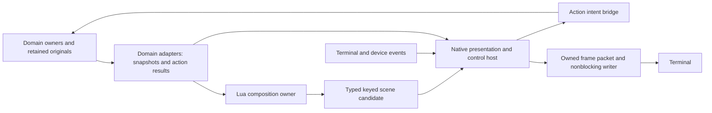

# Owned reusable TUI component design

2026-10-15. Proposed component architecture, grounded by [the source report](../papers/tui-program-2026-10-15/components/REPORT.md). Names and shapes below describe semantic contracts, not implemented APIs. The [TUI doctrine](TUI_DOCTRINE.md) governs this design; [view designs](TUI_VIEWS.md) apply it to particular domains. This document owns the shared presentation/control mechanisms they require.

Current implementation includes checked native SceneHost/local-state primitives
and the containing ChatPresenter integrated into actual terminal output. The
remaining scene visual properties/renderer, separate Lua composition owner,
invocation bridge and reuse across conversation/command center are design scope.
See [delivered source results](../papers/mac-link-repair-2026-10-15/RESULTS.md) and
the [next-slice source map](../papers/tui-next-components-2026-10-15/SOURCE_MAP.md).

## Boundary and data flow

The reusable native layer should have no compile-time dependency on providers, tasks, colleagues, capabilities, workflow execution or Blackbird session selection. It may use owned values, owned result/error types and a narrow capture interface. Blackbird supplies adapters to its existing runtime and raw-event boundaries. The initial reusable code can live within this repository; reuse does not require publishing a separate package, plugin ABI or dependency ecosystem.

The adapter-to-host path supplies bounded native data for local controls and essential state. It does not give the host mutation authority over the domain. A model may address those same domain actions directly without going through screen coordinates or pretending to press a key.

## Ownership

| Owner | Owns and may mutate | Receives | Must not do |
| --- | --- | --- | --- |
| Terminal host, one native execution owner | Descriptors/modes, decoder state, device instance state, native control state, focus, layout state, accepted scene, queued frame packet and writer offsets | Input events, scene candidates, bounded adapter snapshots/results | Run Lua or blocking domain work while servicing input/output; let a component write terminal bytes. |
| Composition worker, one Lua VM owner | Lua environment/modules, composition-local state, candidate scene builders and pending composition requests | Immutable view inputs, local control notifications, async resource results | Enter the terminal owner's VM or memory concurrently; hold terminal locks; execute effects as part of measurement/painting. |
| Domain adapter owner | Bounded current observation, collection cursors, source references, subscriptions, argument/result conversions | Domain publications and UI query/action intents | Invent operation completion, drop authoritative records to free display space, or turn row IDs into domain authority. |
| Existing runtime/effect owner | Actual work, operation admission, cancellation/settlement, capabilities and generations | Checked semantic requests | Depend on a view staying alive for an accepted effect to settle. |

Queues transfer owned values or immutable shared owners. A borrowed `string_view`, Lua stack index, widget pointer or registry slot never crosses a queue as if it were owned. Original payloads remain shared by reference where their current lifetime contract permits; presentation does not clone retained history just to show a page.

## Typed scene and component identity

A scene is a native owned hierarchy of layout containers and typed controls. Each node has a view-instance namespace, stable node key, component kind/version, immutable properties, child keys, and optional domain reference/action descriptors. Child order is layout order, not identity. Duplicate keys under the same parent reject the candidate, with a diagnostic locating the duplicate. Reusing a key for a different component kind retires incompatible local state; it must not reinterpret an old editor buffer as a slider value.

Three identity systems remain distinct:

- A **node handle** locates local control state within a live view incarnation.
- A **domain reference** names the task, artifact, participant, context revision, attempt or service observation being represented, with the environment/incarnation/revision dependencies that operation requires.
- A **scene revision** identifies the geometry/properties/action bindings published together.

Native handles use checked owner/incarnation/generation fields. Interned keys may accelerate lookups, but their numeric storage slot is not a stable external reference. A domain operation resolves and checks its actual reference at dispatch. It does not trust a still-valid widget handle as proof the domain object still exists.

Build and validate a candidate without mutating the accepted scene. Publish its geometry, native-control bindings and action descriptors together. Validation rejects cycles, duplicate keys, invalid geometry, unsupported values, unavailable handles and inconsistent collection/query revisions. Failed composition retains the last good scene and local state, with a native diagnostic and repair/reload access. This publishes presentation coherently; it is not rollback of effects admitted by a separate earlier action. Composition itself cannot admit effects under the native phase contract below.

## C++/Lua contract

Lua composes controls through owned constructors and immutable input snapshots. Builders carry typed node properties; local construction may use ordinary Lua tables, but the boundary converts directly to tagged native values and owned spans. No stringify/reparse, internal JSON, arbitrary Lua object graph, function pointer or VM userdata becomes the scene representation.

The API needs these conceptual operations:

| Operation family | Contract |
| --- | --- |
| Read view input | Returns an immutable revisioned snapshot or checked borrowed view usable only within the protected call. A retained Lua reference does not pin an unlimited history tail. |
| Build keyed control/container | Validates dimensions, text, child identity and typed properties. Strings remain backed by a retained owner or copy exactly once into candidate storage. |
| Read/update local control state | Names a checked node handle and expected state revision when necessary. Changes submit to the native owner; Lua does not edit native memory. Native editing/navigation works without a Lua callback per key. |
| Bind an action | Records an action identity, resolved/late-resolved target policy, typed arguments, relevant generation/revision dependencies and local/effect classification. It does not embed a raw Lua closure in the input owner. |
| Declare/query view observation | Declares a keyed bounded read-only owner observation allowed in composition; returns a resource handle and delivers results with source/view/query generation. It cannot hide external invocation or domain mutation. |
| Submit domain operation | Requires native action-handler phase and identified invocation envelope; admits asynchronously through the actual owner and returns its receipt/result or explicit unresolved disposition. Composition/validation/preview reject it before queue acceptance. |
| Handle local semantic event | Invokes a named Lua handler on the composition owner with owned event values. Arbitrary Lua code can compose native local actions and async requests, but its execution cannot stall the input owner. |
| Publish composition | Completes one validated scene candidate against a named view-input/local-state revision. Conflicting local state is preserved or explicitly rejected; publication cannot overwrite more recent typing. |

### Native call phases and action admission

The bridge enforces call phase at native admission, before an effect intent enters any queue. A non-forgeable phase context belongs to the VM invocation, not a string or boolean supplied by Lua. Composition, validation and display-preview phases can build descriptions and declare bounded read-only view queries. They cannot submit effectful operations. Native measure/paint has no Lua entry at all. An explicit action-handler entry can issue operations through the checked bridge; scene refresh, reload and a failed candidate never manufacture that entry.

Read-only view queries are restricted to owner-declared observation interfaces with bounded examined work and no domain mutation or external dispatch. A method named `get` or a nominal HTTP read is not automatically such an interface. MCP resource fetch, prompt resolution, external refresh and provider calls use explicit operation admission where their actual contracts require it. Declaring a desired cached observation in a composition is keyed by view/query identity; redraw does not create another external invocation. UI bindings expose no synchronous `io`/`os` execution or native-library loader that bypasses these phases. Expert-authored arbitrary work remains available through ordinary asynchronous owned operations.

Each intentional trigger has an origin identity; each requested operation has a fresh invocation identity, origin event/handler generation, target reference, typed input snapshot and relevant revisions. A handler may deliberately submit multiple operations; they receive distinct identities. A repeated delivery or continuation of the same submitted invocation retains its identity, rather than silently allocating another one. An action-definition ID is never its invocation key.

The bridge retains its accepted envelope/receipt until it can expose the actual owner reference or an unresolved disposition, independently of the view's lifetime. Pass an invocation key into the existing domain owner's reconciliation/dedup mechanism where supported. An accepted owner operation whose acknowledgment is lost is inspected/reconciled by that identity; it is not automatically resubmitted after reload. When an owner cannot reconcile ambiguous delivery, preserve unknown and offer a deliberate new attempt. Two genuine triggers remain distinct. Domain results and durable recovery stay in the domain owner; the bridge does not introduce a second authoritative operation ledger or promise exactly-once remote effects.

The runtime's current protected Lua-call/error/ownership rules apply. VM callbacks have one owner, errors preserve useful diagnostics, and native exception conversion does not accidentally catch Lua's private control transfer. No Lua callback runs from device/backend threads or native finalizers.

UI-native bindings provide finite construction, text/layout/control operations and asynchronous domain access. They do not perform synchronous provider calls, process waits, filesystem scanning or arbitrary blocking library calls. This API boundary protects terminal service without removing the expert's ability to run such work through ordinary owned operations. A separate process can be added if arbitrary native extension fault containment is actually required; a thread is not that boundary.

## Capacity and admission of presentation work

A host exposes its supported geometry/text profiles, maximum accepted candidate/window/request shapes and queue/storage capacities before a view starts using them. The application chooses capacities from its intended work and actual costs; this document fixes no byte, item, latency or RSS constant. Capacity is an ownership/failure contract, not a claim that minimal memory use is always best.

Candidate builders check node count, text/blob extents, depth and all dimension arithmetic while constructing. Allocation/capacity failure rejects the candidate and releases its staged owners; the last good scene remains usable. A VM allocation failure uses a minimal native diagnostic path rather than allocating a second elaborate error view. A failed native local edit retains the previous draft and reports that the edit was not accepted; it never silently drops part of a paste and reports success.

Each async request names a finite result/window limit and finite outstanding-request slot. A full presentation-request queue rejects or supersedes an undispatched request explicitly; only the originating request owner can report cancellation of work already dispatched. A full semantic-action queue reports that the action was not accepted. It cannot return an acceptance identity and later discard the intent to free space. A domain result remains queryable from its owner if a closed or slow view no longer subscribes.

Native control service and its minimal feedback need reserved usable resources under the declared supported load, including the existing raw-capture control-credit rules. Exhaustion outside that envelope follows the existing explicit emergency/control and recording-failure behavior; the toolkit cannot invent lossless operation through indefinite storage exhaustion. Superseding unstarted presentation is a different policy from refusing an action, editing a draft or preserving an emitted raw record.

## Native local interaction and input

Decode terminal byte streams independently of text editing. Preserve negotiated encoding, key identity, modifiers and press/repeat/release where available, committed text, paste boundaries, focus loss and terminal replies as distinct events. A controller adapter adds device-instance identity, timestamp clock domain, discrete transitions and absolute/relative values. Unsupported gestures remain inspectable through the binding/help surface; legacy terminals cannot supply information that never reached the PTY.

Native local controls handle cursor movement, text insertion/deletion, selection, scroll, popup focus and simple value editing. This supplies immediate useful behavior when composition is slow. They emit semantic local-state changes to Lua asynchronously. Arbitrary user-defined chord/action policy can still run on the composition owner; an acknowledged local trigger is not automatically an accepted domain operation.

Input routing has an explicit scope stack: a host emergency/control path, then the active modal scope, focused control, containing scopes and view/application bindings. Capturing a prefix retains its origin scope, target and mapping generation. Resolution specifies deadlines, repeat behavior, conflicts and failed-prefix disposition. “Bubble until something handles it” must not execute the same effect twice. A binding inspector can explain negotiated events, scope/mode matches and which definition won.

Focus, selection, scroll anchor, text cursor and domain target are independent state. Focus may select a control without selecting an item; selecting text must not silently retarget a running process. A collection selection stores item identity; scroll stores an item/line anchor plus offset and whether the operator follows the tail. Deletion or filtering uses an explicit policy—retain hidden selection, select a neighbor, or clear it—and displays the resulting state. Inserting output above an inspected item does not force tail-follow.

If removal moves local focus to a neighbor, it clears any armed action/held-gesture target; a fresh deliberate action is required before acting on the replacement. A shared selection model can link an overview and inspector explicitly by domain reference. It does not install an application-wide implicit current target that unrelated views or model operations inherit.

Mouse hit testing captures the acquisition-time emitted geometry revision and resolves the local/domain target into the owned event envelope immediately. Queued events, prefix resolution and held gestures retain that revision/target; later scene acceptance or frame completion cannot reinterpret old coordinates against a new row. Pending geometry transitions or unattributable input use an explicit conservative policy: local select/inspect remains possible, but an effectful coordinate gesture is refused when a stable target cannot be established. A retry is deliberate. The retained emitted-frame geometry is the best host observation, not a frame identifier supplied by the PTY mouse protocol. That revision means bytes submitted, not proof the terminal physically painted them or the human saw them. Delayed terminal reports can lack enough information to establish what was visible at physical input time; this policy cannot detect every such delay or claim a physical-display guarantee. Keyboard navigation can legitimately advance logical focus ahead of paint; subsequent actions use that explicit local focus state. The host must not infer a new row target from a stale screen coordinate or promise to know physical display timing it cannot observe. Dangerous stale/freshness-dependent actions need their actual domain dependencies checked.

## Shared component families

This inventory states ownership and semantics rather than a menu of screenshots.

| Shared family | Native mechanism | Lua/domain responsibilities |
| --- | --- | --- |
| Text/document/code/result surface | Styled runs, safe control-byte presentation, grapheme/cell maps, clipping, anchors, copy/selection, incremental document revisions | Markdown/syntax/domain annotations, source references, useful expansion and retrieval. Conversation is one document adapter. |
| Layout/pane/overlay | Row/column, split, bounded grid, padding/border, min/preferred/max dimensions, clipping and scroll viewport; deterministic rounding | Arrangement, priorities and breakpoints; no allocation proportional to unconstrained content merely to discover the viewport. |
| Collection/table/tree | Keyed item selection, window/cursor, columns, header/body geometry, expansion and known/unknown extent | Item identities, sorting/filtering semantics, typed cell properties and hierarchy relations. Native tree expansion is not domain task mutation. |
| Inspector/detail | Read-only property/result tree, references, expansion, local navigation and return anchor | Domain labels, state meanings, provenance, effective/pending/failed/unknown distinctions and available actions. |
| Editor/form/value controls | Native draft/revision, multiline editor/history, typed field editing, local validation, dirty/conflict states, numeric/range/choice/button controls | Domain schema and authoritative validation; explicit submit/apply semantics. A field becoming valid locally does not admit an effect. |
| Action palette/help/binding inspector | Searchable action rows, prefix continuation, typed argument entry, focused readable help and explanation | Action catalog from actual available definitions, semantic descriptions, scope and target. Search results are versioned; choosing cannot invoke a stale closure. |
| Status/progress/notice/error | Stable compact segments, progress with unknown extent, persistent actionable diagnostics, expandable error detail | Domain outcome and state; unknown duration/progress cannot be drawn as measured completion. Notifications do not steal focus by default. |
| Timeline/chart/sparkline | Axes/units labels, viewport/selection, shared cursor, gaps/uncertainty marks, render mapping of supplied series | Domain supplies prepared series, scope, clock domain, source/query revision and omissions. Metrics transformations stay in the separate processing architecture; drawing does not secretly compute writer-side aggregates. |
| Image/graphic/preview | Owned image resource handles, cached placement, terminal capability fallback, coherent packet lifecycle | Source preparation and asynchronous conversion; aesthetic composition. An optional image must not hold the control path. |
| Async resource/error boundary | Loading/ready/partial/failed/stale/cancel-requested state, result-generation check, retry action descriptor and last-good content | Actual resource request and cancellation/settlement. Hiding a spinner does not cancel its producer. |

Basic controls such as tabs, toggles and segmented choices are compositions over focus, typed local state, layout and actions. They need not each become a separate execution subsystem. Reuse occurs at shared semantics, not merely at drawing a similar border.

Styles use a revisioned theme of semantic roles plus explicit layout/decoration properties. The native renderer resolves tokens to terminal-supported colors/attributes; Lua can compose new roles without copying a fixed conversation-only `Ink` enum into every domain. Focus, selection, activity and error remain distinguishable with textual/shape counterparts. Border sets, spacing, alignment, truncation/expansion, motion preferences and graphic fallbacks are shared visual grammar, not each widget's ad hoc escape sequences.

## Virtual collections and layout cost

A collection provider supplies a revisioned bounded window, stable keys, order/cursor tokens, partial/complete status, and optional known total/locate-key capability. It need not provide the entire collection in a Lua table. A token belongs to its query/order revision; mixing windows across revisions fails or requires an explicit provider-defined reconciliation. Unknown total remains unknown.

Native navigation within available rows is immediate. Reaching a missing window requests data asynchronously and preserves the desired anchor; a loading placeholder cannot become a selectable domain object. Lua composes row descriptions for requested windows on its owner. Providers can return native typed cell models for high-rate tables so scrolling does not wait for a bespoke Lua callback per cell. Uniform-height rows give exact rank/offset mapping. Variable-height rows need a height index or estimated geometry with explicit anchor correction; painting only visible rows alone does not make locating a deep row cheap.

Layout uses checked cell rectangles and finite constraints. Containers assign child bounds; leaves measure within assigned width. The initial contract avoids unconstrained mutually dependent sizing loops: wrapping depends on the provided width, and a scrolling body's intrinsic height does not force its parent to allocate all content. At zero/tiny dimensions, controls return empty/clipped layouts and a native minimal fallback preserves draft and essential controls.

Invalidation is explicit by source revision and node/subtree dependency, not by assuming arbitrary in-place mutation of Lua tables is observable. Cache keys include content/style revision, width profile, geometry constraints and relevant control state. A new character in one draft must not format hidden history or invalidate every chart. A width/profile change may legitimately invalidate much more. Shared immutable payloads retain useful storage; caches have finite eviction/lifetime rules and visible misses, without arbitrary global RSS goals.

## Text and terminal correctness

Use one owned text/layout service across editor, wrapping, selection, table clipping and rasterization. Keep byte offsets, Unicode scalar positions, grapheme boundaries and terminal columns distinct. Preserve original bytes separately from the safe display representation; raw tool escape sequences cannot become UI control commands. Width policy is a negotiated/configured terminal profile with declared tailoring and fallback. A convenient cluster heuristic must not be described as complete Unicode conformance.

Wide-cell continuation and combining/complex clusters have explicit grid representation and clipping rules. Resizing cannot leave half of a wide glyph or a cursor outside physical bounds. A palette, table or form cannot adopt a different byte-to-column policy than the renderer. Actual terminal/multiplexer width disagreements remain observable limitations; an internal grid oracle does not establish every emulator's visible output.

## Backpressure, scheduling and frame publication

Retain the existing nonblocking single writer. A frame owns immutable bytes, the terminal baseline it was derived from, the target grid, cursor, geometry revision and relevant resource references until completion. Because current `ChatOutput` borrows a string view, adapting it requires an explicit containing owner; a temporary prepared string is invalid. Do not mutate the in-flight target grid after preparation.

Completed output advances the painter baseline. Obsolete unstarted frames may be superseded; arbitrary deltas or half-emitted escape sequences may not. A newer scene can be accepted while a packet drains, but its future delta is prepared against the state actually established by that packet. Resize invalidates future geometry and schedules a coherent latest frame after the retained suffix. The host includes pending draw/gesture/query deadlines in its wake plan, so a lone update eventually paints without another key.

Input, control, domain observations, composition results, drawing and writes receive bounded service. A drain-until-empty policy can starve the other classes under perpetual production. Bounds concern real work units, not nominal FPS. A pending control operation cannot be hidden behind a queue of obsolete display frames. The scene queue can retain the latest compatible candidate; accepted actions, discrete input transitions, originals and raw emitted metric records do not inherit display-coalescing permission.

The native host maintains a small last-good shell for draft, current focus/target, composition-error/busy indication and essential control results. Lua interruption uses a protected instruction hook or equivalent bounded work for its owned calls; this limits pure-Lua work without pretending to kill a native callback. If the composition worker becomes stuck, input/native controls and the runtime action bridge still make progress. Reload waits for actual VM quiescence; it cannot free a live VM or detach an unjoinable thread and call that recovery. Process-level containment remains a separate possible design decision.

## Lifecycle, resources and reload

A view instance owns subscriptions, native handles, async presentation requests, Lua generation and its local-state namespace. Closing retires that namespace, clears transient holds, cancels presentation-only requests where supported, removes subscriptions and prevents stale result publication. It does not cancel already accepted domain effects unless the operation's explicit lifetime says so. Results retain their original action/request identity even if their initiating view closes.

Async results carry view incarnation, request/query revision and source reference. Publication checks both the current query and target view. An obsolete result may remain inspectable in its owning operation history while being rejected as current presentation. Disconnect/focus loss retires instance-bound gestures and device feedback; reconnection creates a new instance. Latest absolute preview, relative deltas and discrete buttons have different aggregation rules.

Lua reload prepares a new environment and scene candidate. Native local state can be adopted only through an explicit versioned state description for compatible node keys; no old closures/userdata/stack slots transfer. Persistent drafts and navigation state use owned native binary records where retention is wanted. Governing runtime programs retain the established activation-after-work rule; replacing a presentation definition does not silently activate a pending workflow definition. Old callbacks/resources pin the owning generation until actual settlement, and a failed candidate leaves the last good view available.

## Existing capabilities and future domains

| Present/future surface | Component reuse | Authority or behavior that stays in its owner |
| --- | --- | --- |
| Current conversation, composer, queue, slash/palette, tool detail | Document, native editor/history, list, action palette, inspector | Turn invocation, queued-input identity, exact originals and cancellation settlement. |
| Current task pane/session choice | Keyed collection, table/tree, status, choice palette | Task publications/counts, session switching and active-operation restrictions. |
| Current command foreground/private PTY and external editor | Document/input surface, native host handoff and focus | Existing job IDs/input ordering/limits, terminal restoration and editor accept/draft rules. Private PTY text is not promoted to a terminal emulator. |
| Existing startup/status avatar and tiny-window behavior | Graphic resource, status and minimum layout | Existing image assets/fallback and meaningful state coloring; no gratuitous redesign by extraction. |
| Command center/team | Linked collections, inspector, shared selection and action help | Participant/workflow identity, roles, messages, operation disposition and admission. |
| Mods/capabilities | Catalog, typed form, diff/detail inspector, effective/pending/error status | Actual availability, configuration revision, activation timing, execution and runtime authority. A green toggle is not proof a capability loaded. |
| Hooks/action fabric | Event/action inspector, typed mapping form, causal timeline and live partial results | Event production, ordering, execution, loop prevention, effect capture and policy. Widgets do not invent an independent hook executor. |
| Metrics/trajectories | Time-series/table/timeline, provenance inspector and cross-view cursor | Separate recorder/processor, original source, clock/coverage limits and prepared query results. |

Extraction must preserve the actual current behaviors in these rows before replacing their presentation. It need not build every future domain first. A coherent first application should exercise multiple component families and the authority boundary; moving names between files alone proves little about reuse.

## Direct oracle examples for later implementation

These are concrete acceptance questions, not a request to run another assurance campaign now.

| Contract | Stimulus and direct oracle |
| --- | --- |
| Identity survives reorder | Reorder/insert/filter rows around a selected key and scroll anchor; an independent expected-key sequence determines actual selection and dispatched target. Duplicate keys reject the candidate. |
| Local state survives composition delay | Delay/loop/fail composition while typing, navigating, requesting stop and receiving results; compare editor text/cursor and actual action identities to the submitted event sequence. |
| Composition cannot admit effects | Attempt dispatch from composition, validation and preview; a native admission oracle sees no effect request. Invoke the same operation from an explicit identified handler and observe its real owner receipt. |
| Coordinate target survives publication | Acquire a coordinate gesture under geometry A, publish/reorder B before dispatch, and require the A target or explicit refusal, never a valid but unrelated B target. |
| Ambiguous acknowledgment is not replay | Withhold acknowledgment after owner admission, then restart handler/view; inspection resolves the original invocation or leaves it unknown, without another effect. Distinct deliberate triggers still admit separately. |
| No stale publication | Resolve two async queries out of order and close/reopen the view; only matching query/view generations become current, while the operation's actual result identity remains available. |
| Output remains coherent | Inject every short-write/EAGAIN boundary across a prepared frame, then resize and supersede an unstarted frame; an independent terminal-state decoder matches the expected final cells/cursor and exact packet order. |
| Layout and text agree | Use protocol-derived Unicode/editing cases, narrow clipping and selected real terminal profiles; expected selection/byte references and grid cells are distinct oracles from observed emulator columns. |
| Work stays proportional to useful mutation | Append to one visible row or edit one draft with a large retained corpus; inspect actual layout/build/raster raw work events and bytes outside the writers. An expected invalidation set supplies the mechanism oracle; no invented universal throughput target. |
| Publication cannot overwrite typing | Build a candidate from local-state revision N, accept edits through N+2, then publish; native text remains at N+2 or publication explicitly conflicts. |
| Closing is honest about effects | Close a view with pending preview, accepted command and held device input; preview disposition, retired holds and command settlement each match their distinct lifetime contract. |

Review these contracts with the root design before choosing an implementation slice. The architecture is intended to make new applications reuse reliable interaction machinery while preserving Blackbird's expressive runtime, rather than making all applications obey a conversation-shaped widget hierarchy.
